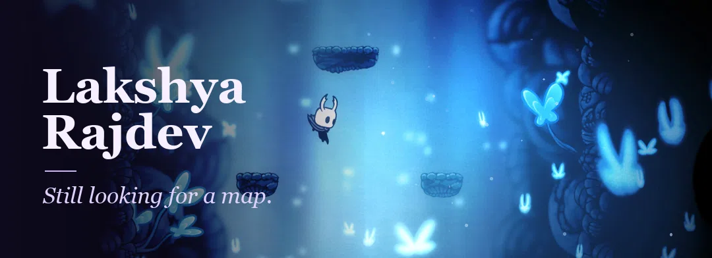

<!-- Blue Cave screenshot and Knight character artwork by Team Cherry.
     Reading frames sourced from https://github.com/ak-2045/hollow-knight-animated-sprite-sheet. -->

  <picture>
    <source media="(prefers-reduced-motion: reduce)" srcset="assets/blue-cave-still.webp" />
    
  </picture>

<table>
  <tr>
    <td align="center" valign="middle">
      <picture>
        <source media="(prefers-reduced-motion: reduce)" srcset="assets/knight-reading-still.webp" />
        
      </picture>
    </td>
    <td valign="middle">
      <h2>Hey, I’m Lakshya</h2>
      
I’m a tech enthusiast with a soft spot for machine learning. Give me a dataset and a question, and I’ll happily spend an afternoon seeing what I can find with a notebook and a few plots.

    </td>
  </tr>
</table>

<table>
  <tr>
    <td valign="middle">
      <h2>What I’m exploring</h2>
      
I’m learning Rust and trying out ML ideas in Python. I like reading just enough docs to give something a go. This usually ends with eleven more docs tabs.

    </td>
    <td align="center" valign="middle">
      
    </td>
  </tr>
</table>

<h2 align="center">Recent GitHub activity</h2>

  

<h2 align="center">Tech stack</h2>

  

