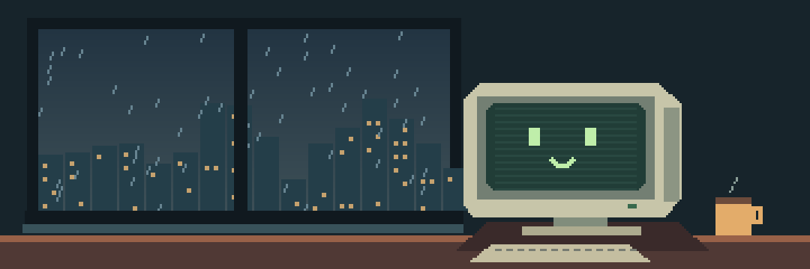

  

# Hey, I’m Lakshya Rajdev

I like building apps that make everyday things a little easier. I’m also the kind of person who tries a new tool just to see what I can make with it.

My favorite bug fix is still “oh, I was running the wrong file.”

<h2 align="center">Tech stack</h2>

  

