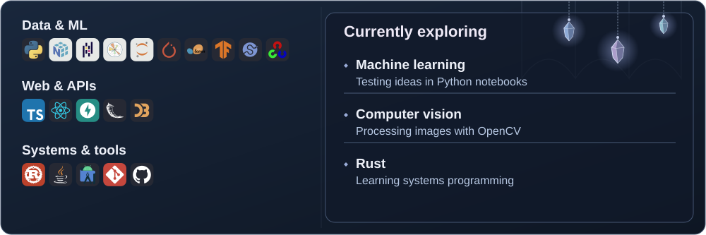
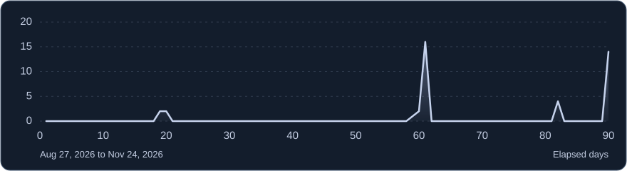

<!-- City of Tears screenshot and Knight character artwork by Team Cherry.
     Banner source: https://hollowknight.wiki/w/File:Screenshot_HK_Knight_05.png
     Reading frames sourced from https://github.com/ak-2045/hollow-knight-animated-sprite-sheet.
     Shade sprite sourced from https://hollowknight.fandom.com/es/wiki/Sombra. -->

  <picture>
    <source media="(prefers-reduced-motion: reduce)" srcset="assets/crystal-dusk-serif-still.webp" />
    
  </picture>

  <picture>
    <source media="(max-width: 600px)" srcset="assets/bio-intro-finished-mobile.svg" />
    
  </picture>

  <picture>
    <source media="(max-width: 600px)" srcset="assets/bio-exploring-finished-mobile.svg" />
    
  </picture>

  
  &nbsp;
  

<h2 align="center">Tech stack</h2>

  <picture>
    <source media="(max-width: 600px)" srcset="assets/workbench-polished-mobile.svg" />
    
  </picture>

<h2 align="center">GitHub activity · Last 90 days</h2>

  

