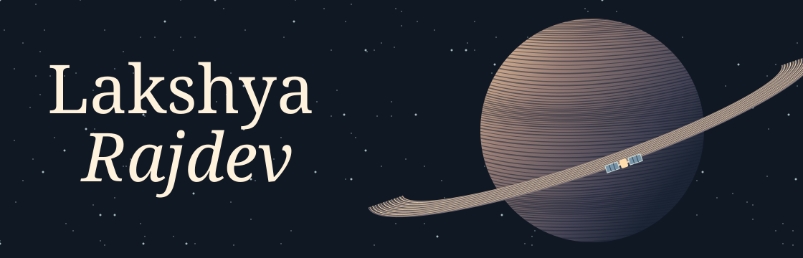
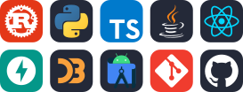

  

<h2 align="center">A little about me</h2>

I build software around two questions. How can a phone make it easier to put it down? And how can a dashboard make a noisy dataset easier to understand? **AttentionTwin** and **Dev Pulse** are my answers so far. I also keep a Rust workspace for smaller experiments in systems programming.

<h2 align="center">Selected work</h2>

  
  
  

- **[AttentionTwin](https://github.com/33GRIM33/casecade)** brings focus sessions, break reminders, scrolling goals, and notification review together on Android. [Download the APK](https://github.com/33GRIM33/casecade/blob/main/release-v5/AttentionTwin-5.0.apk)
- **[Dev Pulse](https://github.com/33GRIM33/Dev-Pulse)** explores developer trends through interactive D3 charts, with React on the frontend and Python and FastAPI behind it.
- **[Rust projects](https://github.com/33GRIM33/rust-projects)** is my collection of systems programming exercises and developer-tool experiments.

<h2 align="center">Tech stack</h2>

  

<a href="https://github.com/33GRIM33?tab=repositories">Explore all repositories ↗</a>

