  

## Hey, I’m Lakshya

I’m a tech enthusiast with a soft spot for machine learning. I like taking a dataset, asking it a question, and seeing how far I can get with a notebook and a few plots. I’m also learning Rust, usually with more docs tabs open than I meant to have.

<h2 align="center">Tech stack</h2>

  

