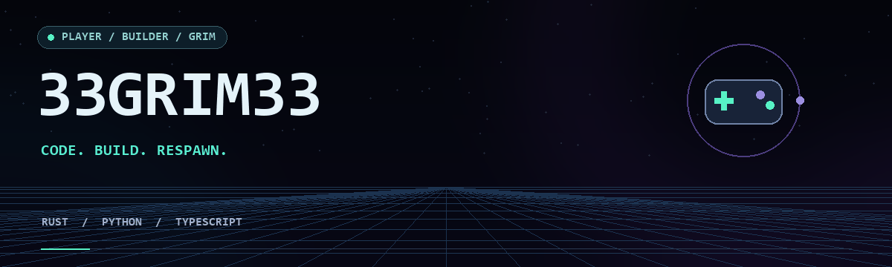
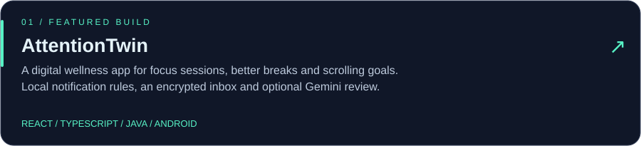
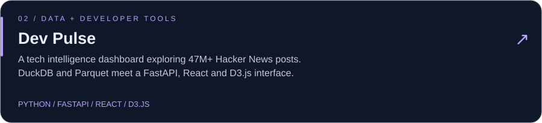
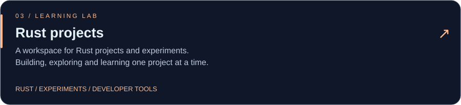

[View the still banner](assets/banner-still.png)

### Digital wellness, developer tools, and data visualization

I build Android tools for more intentional screen time and dashboards that help developers explore technology trends.

[Projects](https://github.com/33GRIM33?tab=repositories) &nbsp; / &nbsp; [AttentionTwin APK](https://github.com/33GRIM33/casecade/blob/main/release-v5/AttentionTwin-5.0.apk) &nbsp; / &nbsp; [Dev Pulse](https://github.com/33GRIM33/Dev-Pulse)

<h3 align="center">Tech stack</h3>

  

## Featured projects

CODE. BUILD. RESPAWN.

