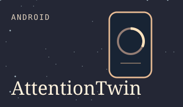
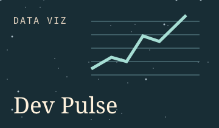
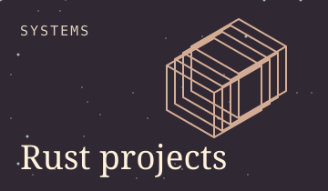

  

Hi, I'm Lakshya. I build Android apps and data tools. AttentionTwin is where I work on focus timers and scrolling habits. When I want to try something smaller, I usually reach for Rust.

<h2 align="center">Projects</h2>

  
  
  

- **[AttentionTwin](https://github.com/33GRIM33/casecade)** lets you set scrolling goals, take breaks, and review notifications on Android. [Download the APK](https://github.com/33GRIM33/casecade/blob/main/release-v5/AttentionTwin-5.0.apk)
- **[Dev Pulse](https://github.com/33GRIM33/Dev-Pulse)** is a dashboard for exploring developer trends. It pairs interactive D3 charts with a Python API.
- **[Rust projects](https://github.com/33GRIM33/rust-projects)** collects my systems programming exercises and experiments.

<h2 align="center">Tech stack</h2>

  

<a href="https://github.com/33GRIM33?tab=repositories">Explore all repositories ↗</a>

